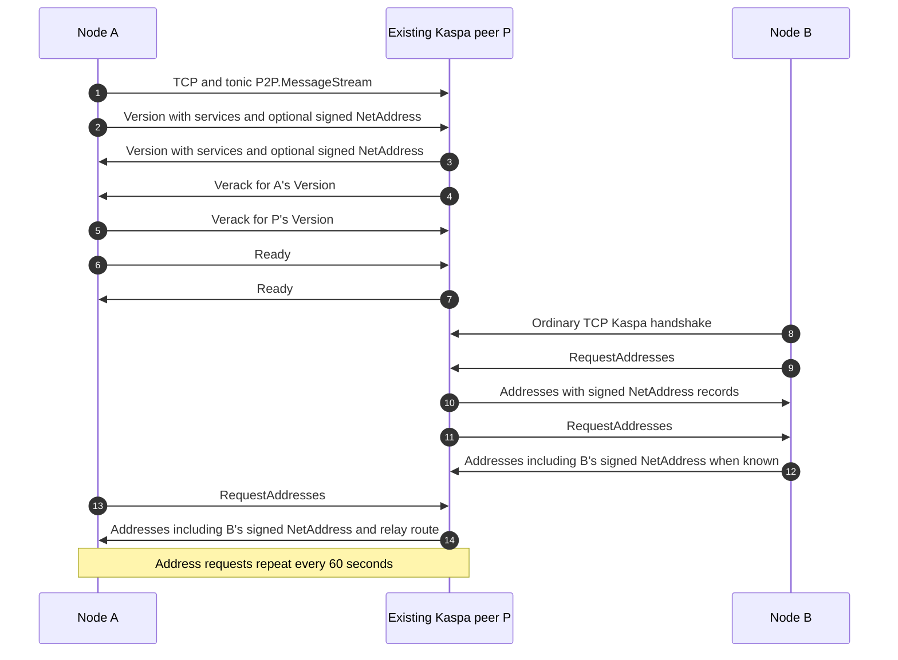
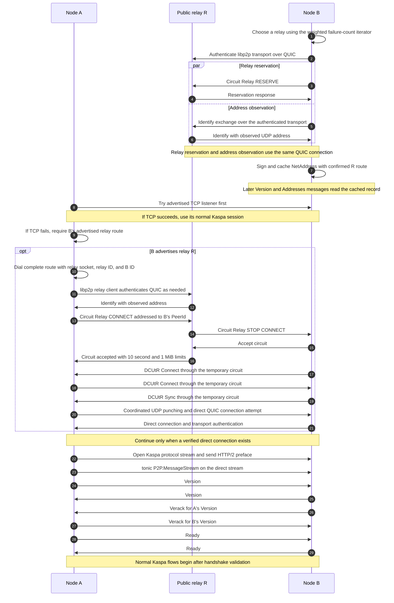

# Hole punching with libp2p

A Kaspa node behind a home router can usually connect to public peers, but other
nodes cannot necessarily connect back to its TCP listener. Two nodes behind NAT
can therefore know about each other and still be unable to establish a normal
TCP connection.

Libp2p adds **UDP hole punching**: a public relay helps the two nodes coordinate
a direct QUIC connection through their NATs. Once that connection exists, Kaspa
uses it for the same handshake, block synchronization and transaction exchange
that run over TCP.

Kaspad starts libp2p automatically alongside TCP. Nodes discover peers and relays
through ordinary Kaspa connections and address gossip. Normal operation requires
no enable flag, manual exchange of endpoint IDs, or manual relay selection.

## How two nodes connect

Suppose A and B are behind NAT, and R is a publicly reachable Kaspa node that can
serve as a libp2p relay.

1. **Bootstrap through TCP.** A and B connect to existing Kaspa peers. Handshakes
   and address gossip teach them which nodes offer libp2p relay service.
2. **B reserves a route through R.** This lets other peers contact B for
   hole-punching coordination. We call R B's *home relay*. B includes that relay's
   address and identity in its own address record, which spreads through normal
   Kaspa gossip.
3. **A tries B's TCP address first.** If it fails, A uses B's advertised relay
   route to request a temporary circuit through R to B.
4. **A and B coordinate hole punching.** Over that circuit, libp2p's DCUtR
   protocol exchanges their UDP address candidates and coordinates direct
   connection attempts. Sending packets from both sides can allow each NAT to
   admit traffic from the other peer.
5. **The Kaspa session starts on the direct connection.** After QUIC establishes
   an authenticated connection between A and B, they open the gRPC stream and
   perform the normal Kaspa network/version handshake. Existing P2P flows then
   use that stream.

R carries coordination traffic, while blocks and transactions travel directly
between A and B. Waiting for a direct connection before opening the Kaspa stream
keeps synchronization traffic from consuming relay bandwidth.

A uses **B's** home relay to reach B. Selecting a home relay for A provides a route
for peers contacting A; it does not change B's route. A relay reservation is a
standing arrangement for accepting coordination requests, rather than an active
Kaspa session.

See the [message flow diagrams](#message-flows) for the protocol exchanges.

## What happens when a connection fails

Hole punching depends on the NATs and firewalls involved. If a direct path cannot
be established, that libp2p attempt fails. Kaspa messages are never sent over the
relay circuit as a fallback. Existing TCP sessions keep working, and the
connection manager can try other peers.

If an established direct connection breaks, reconnecting creates a new session
and repeats the Kaspa handshake. An existing gRPC stream does not migrate to a
relay connection.

Automatic outbound selection allows libp2p sessions to occupy at most half the
configured outbound target: four with the default target of eight. The remaining
slots are available to TCP selection, preserving its policy of spreading peers
across IP prefixes.

## Choosing and serving relays

Nodes try relay candidates learned from Kaspa address records. Weighted random
selection favors candidates with fewer consecutive relay failures. A successful
registration resets that relay's failure count, and a healthy reservation is
kept. Losing it causes the node to try a replacement. Relay failures are recorded
separately from TCP failures, so an unusable relay service does not disqualify a
working TCP peer.

An advertised listener is a candidate, not proof of reachability. A successful
reservation confirms that a client can use that relay. Nodes without libp2p relay
metadata are not tried as relay candidates.

Relay circuits are configured for **10 seconds and 1 MiB of traffic each**, enough
for brief hole-punching coordination. The server allows up to 256 reservations
and 256 simultaneous circuits, with four of each per peer. Reservations can
outlive individual circuits, so closing a circuit does not remove the node's
standing route through its home relay. These allowances apply per circuit;
opening a new circuit starts a new allowance.

## Ports and node identity

The libp2p UDP listener handles relay service, address observations and direct
QUIC sessions. Ordinary Kaspa TCP uses its separate P2P listener.

| Network | Kaspa P2P TCP | libp2p UDP |
| --- | --- | --- |
| Mainnet | 16111 | 16112 |
| Testnet 10 | 16211 | 16212 |
| Testnet 12 | 16311 | 16312 |
| Other testnets | 16411 | 16412 |
| Simnet | 16511 | 16512 |
| Devnet | 16611 | 16612 |

Use `--relay-port=PORT` to change the UDP port. Its default is fixed per network;
changing `--listen` does not change it. When running multiple nodes on one
interface, give each node its own TCP port and its own UDP port.

To serve as a useful public relay, expose the libp2p UDP port through the host
firewall and any router in front of it. Nodes attempting hole punching need UDP
access to their relay and destination peers. They do not need a manually
forwarded TCP P2P port for that connection attempt. A local UDP bind failure is a
startup error; an unreachable remote relay instead triggers another relay attempt.

The node generates a fresh Ed25519 identity at startup and keeps its private key
and signed local address record only in memory. Restarting changes its endpoint
ID and resets the address nonce; peers learn the new record through handshakes
and gossip. During a run, the identity remains stable when its IP address or home
relay changes. Connected-peer RPC reports the
actual connection socket in `address`, with the authenticated identity in
`libp2p_id` for libp2p sessions.

## Current networking constraints

The node updates its signed relay route when its home relay changes, and peers
learn the new record through ordinary address gossip. After initial publication,
the signed IP and UDP-port fields are refreshed on restart; later observations
still update libp2p's hole-punching candidates during the current run.

Simnet and devnet permit private and loopback candidates. In isolated NAT
topologies where nodes use the same UDP port, wildcard listeners can produce
loopback self-dials that prevent session establishment. Binding `--listen` to
the node's actual LAN interface avoids that candidate in the tested topology.

## Message flows

A and B are Kaspa nodes. P is a bootstrap peer: an ordinary Kaspa node whose TCP
address A already knows and uses to discover others. R serves Circuit Relay v2;
P and R can be the same node. Only transport setup is shown, not synchronization.

### Bootstrap and address discovery

Address metadata is sent without a libp2p service flag; legacy protobuf readers
ignore the added fields and read the original IP and TCP port. Each signed NetAddress includes the common
IP, TCP port, relay-service port, endpoint identity, libp2p candidate port,
destination relay socket and identity, nonce, and signature. Identity, ports, nonce and
signature are grouped in optional `libp2p`; `relay_address` remains outside it
and carries both the relay socket and its authenticated Ed25519 identity.
The P2P service signs and caches the owner's address in memory at startup, then
updates it only when the confirmed home relay changes. Handshake and address responses
read this cached record; other nodes forward it unchanged. Fresh records from
handshake or gossip are stored without signature verification. For the same TCP socket and identity, a new
record must verify and either have a greater nonce or replace a record that
does not verify. Handshake advertisements on libp2p must match the authenticated
endpoint ID; signature verification for competing entries belongs to the address
manager. A successful outbound TCP socket is also stored as a separate TCP-only
record. Connected libp2p sockets are never stored as legacy Kaspa TCP listeners.
The Rust `PeerAddress` represents this signed advertisement. Live sessions keep
their verified `SocketAddr` and authenticated `Libp2pId` separately; a connection
may use a different socket from its advertised candidate.

### Relay reservation and direct session

Arrows during DCUtR are logical peer messages carried through R. Kaspa Version,
Verack, Ready and subsequent messages use the direct connection. The Kaspa stream
protocol is disabled on relayed connections. Failed punching does not create a
Kaspa session. Closing the circuit does not close a successful direct connection.
The dialing route contains the destination ID and the relay socket and ID.
No preliminary identity-lookup connection is needed. Libp2p exchanges
QUIC candidates during setup; the gossiped candidate is not passed to the dialer.
A missing relay route or failed relay setup cannot fall back to that candidate.
An already authenticated direct transport connection can be reused.
A direct-path failure ends the Kaspa session; reconnecting repeats the handshake.
